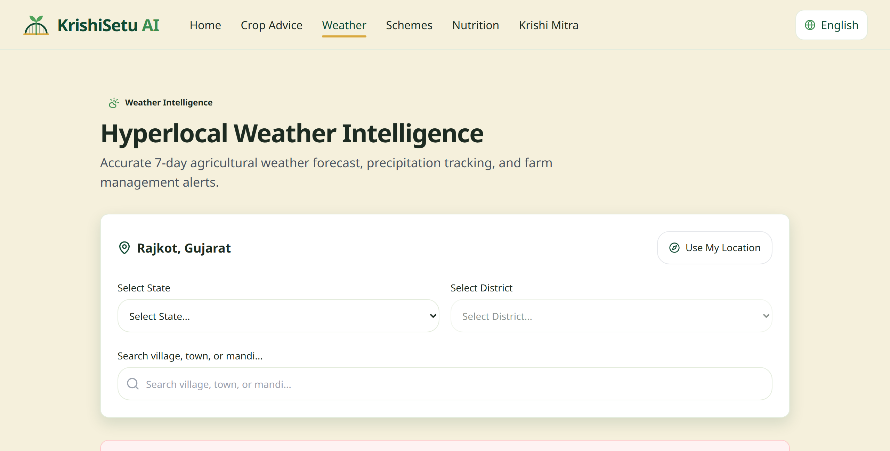
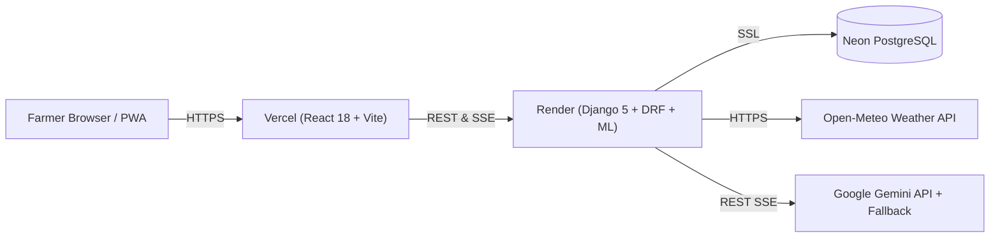

# KrishiSetu AI (कृषिसेतु)

> **Smarter Farming. Better Decisions. Brighter Tomorrow.**

KrishiSetu AI is a multilingual AI agricultural advisory platform for Indian farmers, combining an ML crop recommendation engine, hyperlocal weather intelligence, verified government schemes, crop nutrition profiles, and the **Krishi Mitra** safety-guarded advisory chatbot.


## Live Links
- **Web App (Vercel):** https://krishisetu-ai-sooty.vercel.app
- **API & Swagger Docs (Render):** https://krishisetu-api-cu1y.onrender.com/api/docs/
- **API Health Check:** https://krishisetu-api-cu1y.onrender.com/api/health/

*(Note: The backend runs on Render's free tier and may take ~30–60 seconds to wake up on the first request after inactivity.)*

---

## Live Modules (v1.0)

1. **Crop Recommendation System (CRS)**
   - Analyzes 7 soil & climate parameters (N, P, K, temperature, humidity, pH, rainfall) to recommend top 3 suitable crops with confidence scores.
   - Trained on 2,200 balanced rows across **22 supported crops** (`99.49% ± 0.52%` 5-fold CV Macro-F1; `99.55%` holdout accuracy).
2. **Krishi Mitra Chatbot**
   - Grounded RAG assistant built over **70 verified knowledge chunks** (12 schemes, 22 crops, 31 nutrition profiles, 5 curated guides).
   - Supports SSE streaming and synchronous JSON, non-prescriptive pesticide safety advisories (referring farmers to local KVKs and Kisan Call Centre `1800-180-1551`), and graceful fallback if the upstream LLM is unavailable.
3. **Hyperlocal Weather & Climate Intelligence**
   - Browse **31 Indian States/UTs and 61 districts** (LGD 2026) or use browser geolocation to view 7-day Open-Meteo forecasts and agronomic alerts.
4. **Government Schemes Directory**
   - Search and filter **12 curated Central & State schemes** with verified official portal links (`HTTP 200` checked).
5. **Crop Nutrition Explorer**
   - Compare per-100g nutritional profiles across **31 USDA FoodData Central SR Legacy entries** covering all 22 supported crops (with non-food crops cotton and jute accurately flagged).
6. **Multilingual & Offline-Capable UI**
   - **23 Indian language locales** with 100% key parity (`en`, `hi`, `gu` native-reviewed **Ready**; 20 **Beta**), self-hosted `@fontsource` Indic fonts, RTL support (`ur`, `ks`, `sd`), and PWA offline shell.

### Multilingual Preview (English, Hindi, Gujarati)

| English | Hindi (`हिन्दी`) | Gujarati (`ગુજરાતી`) |
|---|---|---|
|  |  |  |

---

## Technology Stack

| Layer | Technologies |
|---|---|
| **Frontend** | React 18, TypeScript (strict), Vite, Tailwind CSS, Radix UI, Recharts, i18next, `@fontsource` |
| **Backend** | Python 3.12, Django 5.2, Django REST Framework, `drf-spectacular`, Gunicorn, WhiteNoise |
| **Machine Learning** | scikit-learn, XGBoost, LightGBM, Joblib (`ml/krishisetu_ml`) |
| **Database** | PostgreSQL (Neon in production), SQLite (local development) |
| **Testing & QA** | Pytest (`92%` backend statement coverage), Vitest, Playwright E2E + `@axe-core/playwright`, Ruff, Gitleaks |

---

## System Architecture



Detailed diagrams (system, data flow, ER diagram, deployment): [`docs/architecture/`](./docs/architecture/).

---

## Development Quickstart

### Prerequisites
- Python 3.11+ (tested on Python 3.12)
- Node.js 18+ (tested on Node 22/24)

### 1. Clone & Environment
```bash
git clone https://github.com/poshiyaharsh/KRISHISETU-AI.git
cd KRISHISETU-AI
cp .env.example .env
```

### 2. Backend Setup (Django 5 + ML + Seed Data)
```bash
cd backend
python -m venv .venv
# Windows: .venv\Scripts\activate
# macOS/Linux: source .venv/bin/activate

pip install -r requirements/dev.txt
python manage.py migrate
python manage.py seed_crops
python manage.py seed_locations
python manage.py load_schemes
python manage.py load_nutrition
python manage.py build_knowledge
python manage.py runserver
```
Backend API runs at `http://127.0.0.1:8000/api/health/` and Swagger UI at `http://127.0.0.1:8000/api/docs/`.

### 3. Frontend Setup (React 18 + Vite)
```bash
cd frontend
npm install
npm run dev
```
Frontend runs at `http://127.0.0.1:5173/`.

### 4. Run Tests & Checks
```bash
# Backend & ML tests + lint
backend/.venv/bin/python -m pytest backend/ ml/tests
backend/.venv/bin/python -m ruff check backend ml
backend/.venv/bin/python -m ruff format --check backend ml

# Frontend tests, lint, typecheck, i18n parity
npm --prefix frontend run lint
npm --prefix frontend run typecheck
npm --prefix frontend test
node scripts/i18n-check.mjs
```

---

## Configuration
All 22 environment variables (`DJANGO_SETTINGS_MODULE`, `DATABASE_URL`, `GEMINI_API_KEY`, `VITE_API_BASE_URL`, etc.) are documented in [`docs/deploy/env.md`](./docs/deploy/env.md) and templated in [`.env.example`](./.env.example).

---

## Data Sources & Attributions
See [`docs/DATA_SOURCES.md`](./docs/DATA_SOURCES.md) and [`NOTICE`](./NOTICE) for full dataset licenses and attributions:
- **Crop Dataset:** Atharva Ingle Crop Recommendation Dataset (Apache-2.0, 2,200 rows, 22 crops)
- **Weather:** Open-Meteo (CC BY 4.0, non-commercial free tier)
- **Nutrition:** USDA FoodData Central SR Legacy (Public Domain / CC0)
- **Locations & Schemes:** LGD 2026 & official Indian Central/State portals

---

## Honest Limitations
- **Crop Scope:** The ML model predicts among **22 supported crops** only; it does not cover every regional crop variety in India.
- **Language Review Status:** English, Hindi, and Gujarati are native-reviewed (**Ready**); the remaining 20 Indian language packs have 100% key parity but are marked **Beta** pending native-speaker review.
- **Advisory Disclaimer:** Crop recommendations and Krishi Mitra responses are decision-support tools, not a substitute for local soil testing or advice from a certified agronomist / Krishi Vigyan Kendra (KVK).
- **Free-Tier Hosting:** Render free-tier web services sleep after inactivity, causing cold-start latency on the first request.

---

## Planned Roadmap (Post-v1.0)
- **Phase 13:** Farmer profiles and personalized dashboard
- **Phase 14:** Crop disease detection from leaf photos
- **Phase 15:** Soil health card / report analyzer
- **Phase 16:** Voice-enabled Krishi Mitra
- **Phase 17:** Mandi price intelligence
- **Phase 18:** Smart irrigation scheduling
- **Phase 19:** Notifications & profitability comparison
- **Phase 20:** Satellite NDVI field monitoring

---

## Documentation & Policies
- **API Docs & OpenAPI Spec:** [`docs/api/README.md`](./docs/api/README.md) | [`docs/api/openapi.yaml`](./docs/api/openapi.yaml)
- **Deployment & Runbook:** [`docs/deploy/runbook.md`](./docs/deploy/runbook.md)
- **Contributing:** [`CONTRIBUTING.md`](./CONTRIBUTING.md)
- **Security Policy:** [`SECURITY.md`](./SECURITY.md)
- **Changelog:** [`CHANGELOG.md`](./CHANGELOG.md)
