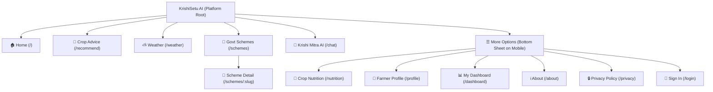

# KrishiSetu AI: Information Architecture & Page Blueprints

> **Guiding Principle:** "One primary decision per viewport."  
> Mobile navigation is thumb-driven via a 5-tab bottom navigation bar (`--bottomnav-h: 68px`). Desktop navigation is streamlined via a top utility and navigation bar (`--header-h: 72px`). The AI assistant (Krishi Mitra) is integrated as a bottom tab on mobile and a floating launcher on desktop to guarantee zero UI overlap.

---

## 1. Global Sitemap & Navigation Tree

---

## 2. Navigation Structure by Form Factor

### Desktop ($1024\text{px} \dots 1920\text{px}$)
- **Top Header Bar (`--header-h: 72px`):**
  - Left: Master Brand Lockup Logo (`<BrandLogo variant="lockup" />`) linking to `/`.
  - Center: Main navigation links in a single row (Home, Crop Advice, Weather, Schemes, Nutrition).
  - Right: 1-Tap Language Selector (showing active native script), Guest/User Profile Avatar Menu.
- **Floating Krishi Mitra Launcher:**
  - Located at bottom inline-end corner (`bottom: 24px`, `right: 24px`, `z-index: 50`).
  - Automatically hidden on `/chat` route.

### Mobile ($320\text{px} \dots 768\text{px}$)
- **Compact Top Header (`--header-h: 56px`):**
  - Left: Compact Brand Lockup (`<BrandLogo variant="lockup" height="36px" />`).
  - Right: Quick Language Switch pill, Account avatar button.
- **Fixed Bottom Navigation Bar (`--bottomnav-h: 68px`):**
  - **Tab 1:** 🏠 Home (`/`)
  - **Tab 2:** 🌱 Crop Advice (`/recommend`)
  - **Tab 3:** ⛅ Weather (`/weather`)
  - **Tab 4:** 📜 Schemes (`/schemes`)
  - **Tab 5:** 💬 Krishi Mitra (`/chat`)
- **"More" Bottom Sheet Trigger:**
  - Accessible via top-right profile avatar or secondary link on Home.
  - Houses: Crop Nutrition, Farmer Profile & Plots, Language Picker, Help & Helpline, About.
- **Floating Button Policy:**
  - **ZERO floating buttons on mobile.** Since Krishi Mitra is Tab 5, no floating bubble obscures forms or cards.

---

## 3. Page Blueprints & State Specifications

---

### Page 1: Home (`/`)
- **Primary CTA:** "Find Best Crop for Your Field" $\rightarrow$ `/recommend`

#### Block Order — Mobile (360px–390px)
1. **Compact Header:** Logo + Language Switcher + Sign In / Account.
2. **Hero Photo Banner (Seed Packet Header):** Real field photo with warm gradient overlay, welcoming greeting, quick weather strip pill (temperature + rain alert).
3. **Primary Action Cards (2 $\times$ 2 Grid):**
   - Tile 1: 🌱 Crop Advice (Recommendation Engine)
   - Tile 2: ⛅ 7-Day Weather & Spray Forecast
   - Tile 3: 📜 Government Subsidies & Schemes
   - Tile 4: 💬 Talk to Krishi Mitra (AI Assistant)
4. **Recent Advisory / Plots Quick Glance (if logged in or guest history exists):** 1-tap link to previous prediction.
5. **Kisan Helpline Trust Banner:** 1800-180-1551 direct call button.
6. **Footer Attribution & Legal Links.**
7. *(Spaced with `--bottomnav-h` padding so bottom bar never covers content).*

#### Block Order — Desktop (1280px)
1. **Full Navigation Header:** Brand Lockup + Nav Links + Language + Auth.
2. **Hero Split Section:**
   - Left: Headline ("Smarter Farming. Better Decisions. Brighter Tomorrow."), short value proposition, primary green button ("Get Crop Advice"), secondary wheat button ("Ask Krishi Mitra").
   - Right: Panoramic photo card of Indian terraced fields with live mini-weather widget.
3. **Core Tasks Row (4 Cards Across):** Large seed-packet cards with authentic photography and action arrows.
4. **Interactive Feature Highlights:** CRS Accuracy metrics, Supported 22 crops carousel, Govt Schemes highlight.
5. **Trust & Safety Section:** Ministry attribution, Kisan Call Centre banner, DPDP Act privacy badge.
6. **Comprehensive Footer.**

#### States
- **Loading:** Skeleton banner + 4 skeleton task tiles with shimmering pale-green gradient.
- **Empty:** Default welcoming state with onboarding prompts.
- **Error:** Warm notification banner with offline helpline phone number (1800-180-1551) and "Refresh Page" button.

---

### Page 2: Crop Advice (`/recommend`)
- **Primary CTA:** "Calculate Recommended Crops"

#### Block Order — Mobile (360px–390px)
1. **Progress Bar & Stepper Title:** Step 1 of 2: "Your Soil & Field Data".
2. **Location Quick Bar:** Current detected district or change location button.
3. **Nutrient & Weather Inputs (Large Stepper Fields):**
   - Nitrogen ($N$), Phosphorus ($P$), Potassium ($K$) with big `+` / `-` buttons and range indicators.
   - Temperature (°C), Humidity (%), Soil pH (3–10), Expected Seasonal Rainfall (mm).
4. **Sticky Submit CTA Button (`--sticky-cta-h: 60px`):** Big high-contrast green button: "Get Recommendations".
5. **Results View (Post-Submission):**
   - Top Crop "Seed Packet" Card (Photo, Name in native script + English, Confidence Badge, Ideal Soil Range).
   - Second & Third Alternative Crop Cards.
   - 1-Tap Links: "Check Nutrition", "Find Schemes for this Crop", "Save to My Plots".

#### Block Order — Desktop (1280px)
1. **Header with Breadcrumbs:** Home / Crop Advice.
2. **Two-Column Form & Preview Layout:**
   - Left Column ($60\%$): Grouped input fieldsets (Soil Nutrients, Climate Conditions) with synchronized numerical steppers and accessible sliders.
   - Right Column ($40\%$): Live input summary card and agricultural guidelines helper box.
3. **Results Section:** 3-column comparative cards with full agronomic parameter breakdowns.

#### States
- **Loading:** Animated seedling growth loader with friendly text: "Analyzing soil parameters against calibrated model...".
- **Empty:** Pre-filled default agronomic baseline values for the selected district.
- **Error:** Clear field-level validation alerts (e.g., "Rainfall cannot exceed 300mm") with inline auto-correction buttons.

---

### Page 3: Local Weather (`/weather`)
- **Primary CTA:** "Check 7-Day Farm Forecast"

#### Block Order — Mobile (360px–390px)
1. **Location Bar:** State & District selector with 1-tap "Use My GPS" button.
2. **Current Day Hero Card:** High-contrast weather card (Temperature, Condition Icon, Rain Probability %, Wind Speed, Humidity).
3. **Agricultural Spray Advisory Alert:** "Safe to spray pesticide today" (Green) or "Heavy rain forecast: Avoid spraying" (Amber).
4. **Horizontal 7-Day Forecast Scroll:** Large cards with day name, weather icon, high/low temperatures.
5. **Rainfall & Temperature Trend Chart:** Responsive Recharts strip chart with touch-friendly tooltips.

#### Block Order — Desktop (1280px)
1. **Top Bar & Location Header.**
2. **Current Weather Hero + Agronomic Warnings Grid.**
3. **Full 7-Day Combined Weather & Precipitation Chart.**
4. **Soil & Evapotranspiration Metric Cards.**

#### States
- **Loading:** Shimmering cards for current weather and 7-day strip.
- **Empty / Geolocation Denied:** Polite location selector dropdown with default state/district choices.
- **Error:** Provider timeout notification displaying cached weather from previous sync with "Refresh Now" button.

---

### Page 4: Government Schemes (`/schemes`)
- **Primary CTA:** "Find Eligible Subsidy Schemes"

#### Block Order — Mobile (360px–390px)
1. **Search & Filter Chips Bar:** Search by scheme name + Quick filter pills (All, Central, State, Solar, Credit).
2. **Schemes Count Badge:** e.g., "12 Verified Schemes for Your State".
3. **Schemes List (Seed Packet Style):**
   - Scheme Title in native language.
   - Sponsoring Ministry Badge (e.g., "Ministry of Agriculture").
   - Key Benefit Pill (e.g., "₹6,000 / year direct benefit").
   - Clear "Read Details & Apply" button.
4. **Pagination / Infinite Scroll.**

#### Block Order — Desktop (1280px)
1. **Breadcrumbs & Header.**
2. **Faceted Layout:**
   - Left Sidebar ($25\%$): Filter by Level (Central/State), Category, Farmer Type (Smallholder, Women, Marginal).
   - Right Content ($75\%$): Grid of schemes cards with search bar and active filter chips.

#### States
- **Loading:** 4 skeleton scheme cards.
- **Empty:** "No schemes match your filter" card with 1-tap "Clear All Filters" button.
- **Error:** "Could not load schemes" banner with direct link to official `myScheme.gov.in` portal.

---

### Page 5: Crop Nutrition (`/nutrition`)
- **Primary CTA:** "Compare Crop Nutritional Profiles"

#### Block Order — Mobile (360px–390px)
1. **Crop Selector Dropdown / Visual Grid:** Select single crop or up to 3 crops to compare.
2. **Edible Form Toggle:** Raw vs Cooked (hydrated).
3. **Macro Nutrient Summary Card:** Calories, Protein, Carbs, Dietary Fiber per 100g.
4. **Micronutrient Pills:** Iron, Calcium, Potassium badges with % Daily Value.
5. **Comparison View:** Side-by-side vertical swipe comparison cards.

#### Block Order — Desktop (1280px)
1. **Top Header & Crop Search.**
2. **Side-by-Side 3-Column Comparative Cards:** Highlighting highest protein, lowest glycemic index, and moisture retention.
3. **Interactive Recharts Nutrition Breakdown Chart.**

#### States
- **Loading:** Skeleton nutrient table and bar chart.
- **Empty:** Prompt card with 3 popular comparison shortcuts (e.g. "Rice vs Wheat", "Bajra vs Maize").
- **Error:** "Nutritional data temporarily unavailable" with USDA FoodData Central source citation.

---

### Page 6: Krishi Mitra AI Chat (`/chat`)
- **Primary CTA:** "Ask Farming Question"

#### Block Order — Mobile (360px–390px)
1. **Chat Header:** Avatar of Krishi Mitra, language indicator, clear conversation button.
2. **Persistent Advisory Banner:** "AI advisory for guidance only. For medical/toxic emergencies, call Kisan Call Centre 1800-180-1551."
3. **Message Thread (Scrollable Area):**
   - User messages in warm wheat-gold bubbles.
   - Krishi Mitra messages in deep-green cards with formatted bullet points, source citations, and copy/speaker button.
4. **Quick Suggestion Chips:** 3 contextual questions in active language (e.g. "कपास में खाद कब डालें?", "કપાસમાં ખાતર ક્યારે આપવું?").
5. **Bottom Fixed Input Bar:** Large text input field + Voice mic icon + High-contrast Send button. *(Bottom tab bar is hidden on this page to maximize message area).*

#### Block Order — Desktop (1280px)
1. **Centered Chat Layout (max-width 840px):** Full-height conversational canvas with clear message typography.

#### States
- **Loading:** Gentle pulsing green typing indicator with "Thinking in [Language]...".
- **Empty:** Welcoming greeting card with 4 sample agricultural queries.
- **Error:** Inline error bubble under user message with 1-tap "Try again" button and fallback to helpline number.

---

### Page 7: Sign In & Authentication (`/login`)
- **Primary CTA:** "Continue with Google" / "Send Verification Code"

#### Block Order — Mobile & Desktop
1. **"Back to Home" Link:** Clear escape hatch at the top left.
2. **Brand Emblem Card:** Centered `<BrandLogo variant="lockup" />`.
3. **Primary Action:** One-tap Google Sign-In button (large, high-contrast, official branding, native language locale).
4. **Terms & Privacy Notice:** Consent disclaimer under Google button.
5. **Divider:** "Or continue with email".
6. **Secondary Action:** Large email input field + "Send Verification Code" button.
7. **Step 2 (Verification):** 6-digit spaced input boxes (`pattern="[0-9]*"`) + 30s resend timer + masked email.
8. **Always Available Escape Hatch:** "Continue as Guest (No Sign In Needed)" link at bottom.

#### States
- **Loading:** Animated spinner inside button.
- **Error:** High-contrast red alert box with friendly text and retry button on network timeout.
